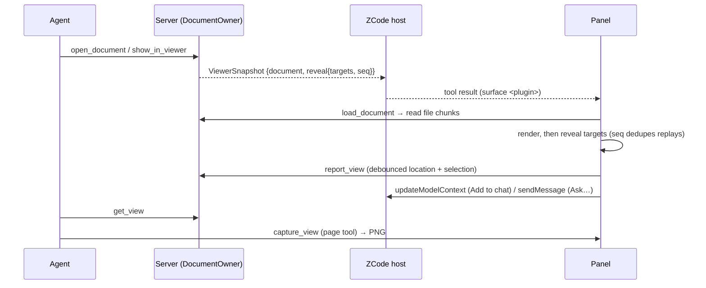

# Office viewer owner and ports

This runtime builds the viewer panels of several plugins. Each built-in plugin package (`apps/zcode-cli/packages/<plugin>-plugin`) declares its panel title and the formats it opens under `office` in its package.json; `scripts/build.mjs` turns that into the plugin's profile (`src/profile.ts`) and keeps only the parsers and viewers of those formats (`src/adapters/parsers.ts`, `ui/viewers/registry.ts`, lines tagged `kind:<format>`). The plugin's name names its MCP server, its panel surface and its resources (`ui://<plugin>/…`). Today `documents`, `spreadsheets`, `presentations` and `pdf` each open one format: docx, xlsx, pptx and pdf. Below, `<plugin>` is the plugin's name.

`DocumentOwner` (`app/documents.ts`) is the only owner of viewer state. Server tools and the panel read and write through it; the plugin never writes workspace files. The owner is process-wide because a workspace-isolated MCP server is shared by every session in that workspace; per-session state lives behind `owner.session(id)`.

- **Documents**: parsed by format (`adapters/parse/*`) into a `ParsedDocument` (outline, paged text, search, locator check). Cached per path and invalidated by size + mtime; the revision is a content hash. The parse cache is shared by all sessions.
- **Anchors** (`domain/anchor.ts`): `<path>#<locator>` shared by panel, server and model. docx `p:N[-M]`, `t:N[/rRcC]`; xlsx `Sheet[!A1[:B2]]`; pptx `slide:N[-M]`, `slide:N/shape:ID` (the shape's `cNvPr` id); pdf `page:N[-M]`. 1-based. `check()` returns the canonical form (e.g. the real sheet name).
- **Session state**: each `owner.session(id)` owns its current document (set by `open_document`, `show_in_viewer`), the panel reports (`report_view` / `release_view`), the reveal sequence and the `load_document` tokens it created. Sessions never see each other's document, views or sequence numbers.
- **Bytes to the panel**: the owner keeps one process-wide handle table so tokens are unique across sessions; the panel reads `ui://<plugin>/file/{token}/{index}` in 4 MiB chunks without a session id. Each session keeps at most `MAX_HANDLES` of its own tokens; dropping a session deletes its handles.

## Sessions

- Every tool call is routed with `owner.session(sessionIdOf(extra._meta))`. The resolver (`src/session.ts`) reads, in order, top-level `root_session_id`, top-level `session_id`, then the same keys under `_meta["com.zcode/request-context"]`. A missing, empty, whitespace-only or non-string value falls through; if nothing matches, the call uses `DEFAULT_SESSION` (`"default"`). It never throws, so older callers keep working.
- The host puts the owning session in both `_meta` shapes for model and panel (`mcp/uiCallTool`) calls, so `report_view`, `release_view`, `load_document` and the import tools land in the same session as `open_document` / `get_view`. Resource reads (`ui://…/file/…`, UI assets) carry no session and only use the shared handle table.
- `MAX_SESSIONS` (`32`) sessions are retained. `session()` refreshes the entry on every access and evicts the least recently used session when the limit is exceeded; eviction calls `dispose()`, which invalidates that session's `load_document` tokens.
- `begin_file_import` passes the session id to the importer: `MAX_IMPORTS` pending uploads are counted per session while the upload table itself stays shared (import ids are UUIDs).

## Tools

| Tool                                                                             | Visibility                                | Panel routing                                               |
| -------------------------------------------------------------------------------- | ----------------------------------------- | ----------------------------------------------------------- |
| `open_document`                                                                  | model, app                                | surface `<plugin>`, opens the panel                         |
| `show_in_viewer`                                                                 | model                                     | surface `<plugin>`, opens the panel                         |
| `read_document`, `search_document`, `get_view`                                   | model                                     | none                                                        |
| `list_documents`, `load_document`, `check_document`, `get_viewer`, `report_view` | app                                       | none                                                        |
| `capture_view`                                                                   | page tool (`app__<plugin>__capture_view`) | defined statically in `ui/host.ts`, bound once the UI loads |

## Panel

The page uses one official `App`; `ui/bootstrap.ts` connects it before loading the UI bundle through resources, keeping every tool result. The sandbox has no network: pdf.js cMaps, fonts and wasm, the pdf.js and react-xlsx workers, the xlsx wasm and the pdf plugin's bundled CJK fallback font (`fonts/*.woff2`, listed in `cjk-fallback.json`) are read as resources (`ui://<plugin>/assets/…`, only those of the plugin's formats); the panel resource declares `zcode/csp.wasmUnsafeEval`. How the PDF panel picks fonts for non-embedded CJK text and normalizes extracted text: `docs/plugins/2026-10-15-office-viewer-builtin-panels-spec.md` §5.
